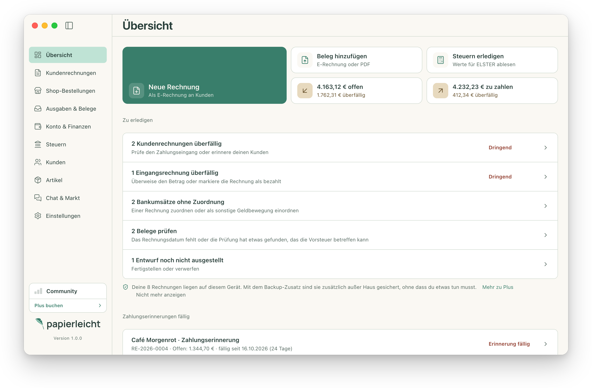
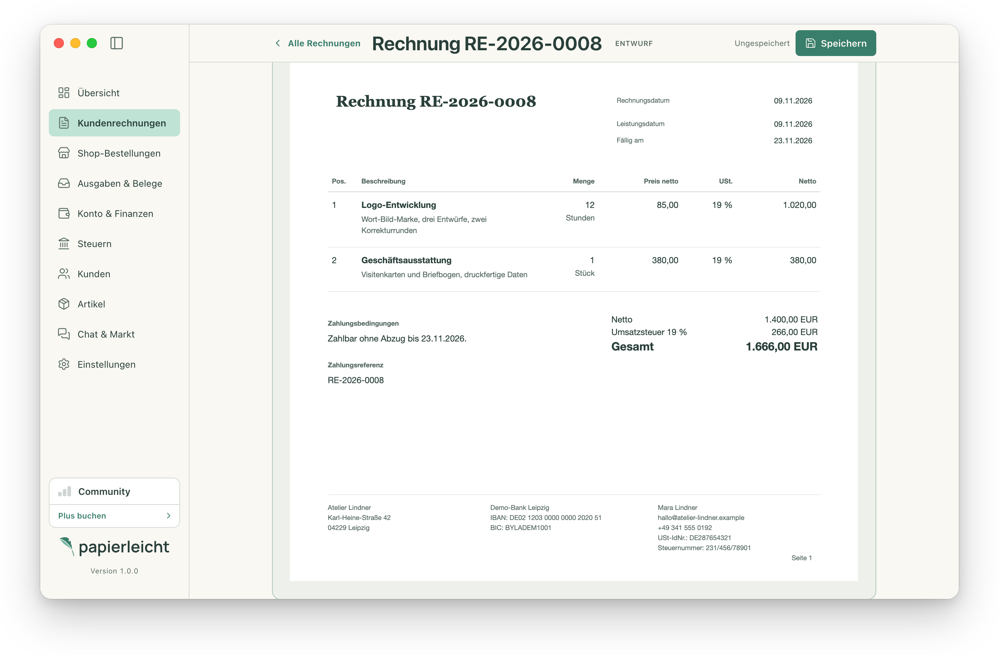
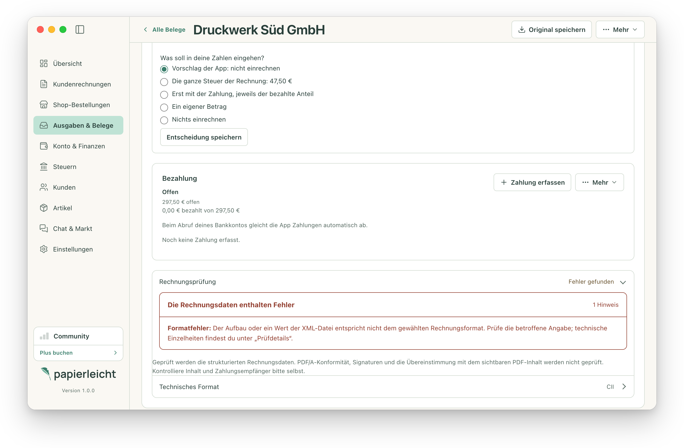
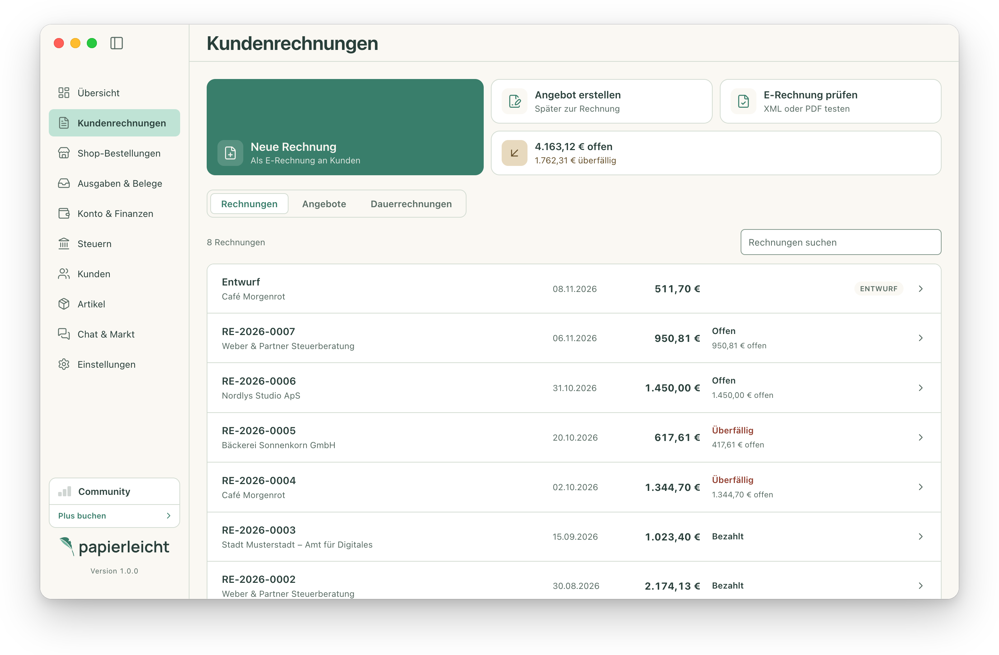
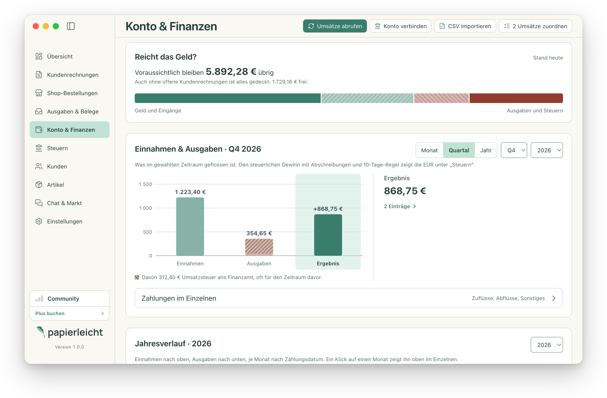

# E-Rechnung-Studio

[](https://github.com/papierleicht/E-Rechnung-Studio/actions/workflows/ci.yml)
[](https://github.com/papierleicht/E-Rechnung-Studio/releases)
[](https://github.com/papierleicht/E-Rechnung-Studio/releases)
[](https://github.com/papierleicht/E-Rechnung-Studio/stargazers)
[](#installieren)
[](go.mod)
[](https://github.com/papierleicht/E-Rechnung-Studio/commits/main)
[](#mitwirken)
[](LICENSE)

**Desktop-App für macOS, Windows und Linux** von papierleicht, für
Selbstständige und kleine Unternehmen in Deutschland: Angebote, E-Rechnungen,
Zahlungen, Belege und Steuerwerte an einem Ort. Die App wird installiert und
läuft lokal auf deinem Rechner, deine Daten bleiben auf deinem Gerät, und für
die tägliche Arbeit brauchst du weder Internet noch Konto. Entwickelt mit Go,
Wails 3 und Svelte.

**[Herunterladen](https://github.com/papierleicht/E-Rechnung-Studio/releases/latest)** ·
[Demo im Browser](https://papierleicht.de/?utm_source=github&utm_medium=readme&utm_content=linkzeile-demo#demo) ·
[Videos](https://www.youtube.com/@papierleicht) ·
[Website](https://papierleicht.de/?utm_source=github&utm_medium=readme&utm_content=linkzeile-website) ·
[Releases](https://github.com/papierleicht/E-Rechnung-Studio/releases) ·
[Changelog](CHANGELOG.md) ·
[Sicherheitslücken melden](SECURITY.md)

<picture>
  <source media="(prefers-color-scheme: dark)" srcset="docs/screenshots/uebersicht-dunkel.png">
  
</picture>

<sub>E-Rechnung-Studio als Programmfenster unter macOS, mit Beispieldaten. Unter
Windows und Linux läuft dieselbe App im Fenster des jeweiligen Systems; sie
folgt dem hellen oder dunklen Erscheinungsbild des Systems.</sub>

## Was du mit der App machen kannst

- **Angebote & Rechnungen:** Angebote schreiben und in Rechnungen umwandeln;
  Rechnungen, Gutschriften, Anzahlungs- und Dauerrechnungen mit eigenen
  Nummernkreisen.
- **E-Rechnungen erzeugen:** XRechnung 3.0 in CII und UBL sowie
  ZUGFeRD/Factur-X BASIC, EN 16931 und EXTENDED, als PDF/A-3b mit
  eingebettetem XML.
- **E-Rechnungen prüfen:** eigene und empfangene XRechnungen und
  ZUGFeRD-Rechnungen offline prüfen, mit Regel-ID und verständlichem Hinweis.
- **Per E-Mail versenden:** Rechnungen, Angebote und Zahlungserinnerungen über
  dein eigenes SMTP-Konto.
- **Zahlungen & Mahnungen:** offene Posten mit Teilzahlungen, Ratenplänen,
  Zahlungserinnerungen und Mahnungen; Zahlungshinweise und SEPA-QR-Code.
- **Ausgaben & Belege:** Eingangsrechnungen als PDF oder XML einlesen,
  Kassenbons und Fotos erfassen, Anschaffungen abschreiben.
- **Konto & Finanzen:** Kontoumsätze per CSV importieren oder per FinTS abrufen;
  die App schlägt passende Rechnungen vor. Einnahmen, Ausgaben und Ergebnis je
  Monat und Jahr, dazu „Reicht das Geld?“ mit offenen Posten und anstehenden
  Steuern.
- **Steuern:** Steuertermine und Werte für Mein ELSTER (Umsatzsteuer-Voranmeldung,
  Zusammenfassende Meldung, EÜR) und eine Jahresübersicht nach Steuerart mit
  Umsatz-, Einkommen- und Gewerbesteuer.
- **DATEV-Export:** Buchungsstapel und Belege für die Steuerkanzlei.
- **GoBD:** fortlaufendes Änderungsprotokoll, Prüfer-Export und
  Verfahrensdokumentation.
- **Shop-Bestellungen:** Shopify, WooCommerce, Shopware 6, Gambio, Wix und
  PrestaShop verbinden und Bestellungen als Rechnungsentwurf übernehmen.
- **Chat & Markt:** Austausch mit anderen Selbstständigen sowie Angebote und
  Gesuche.
- **Sichern:** Daten sichern und wiederherstellen.

<table>
  <tr>
    <td width="50%" valign="top">
      <a href="docs/screenshots/rechnung-erstellen.png"></a>
      <br><b>Rechnung schreiben:</b> direkt im Dokument; Summen und Umsatzsteuer rechnet die App.
    </td>
    <td width="50%" valign="top">
      <a href="docs/screenshots/e-rechnung-pruefen.png"></a>
      <br><b>E-Rechnung prüfen:</b> Befund in einem verständlichen Satz, Vorschlag der App, Entscheidung bei dir.
    </td>
  </tr>
  <tr>
    <td width="50%" valign="top">
      <a href="docs/screenshots/kundenrechnungen.png"></a>
      <br><b>Kundenrechnungen:</b> offen, überfällig oder bezahlt auf einen Blick.
    </td>
    <td width="50%" valign="top">
      <a href="docs/screenshots/finanzen.png"></a>
      <br><b>Konto & Finanzen:</b> „Reicht das Geld?“ und Ergebnis je Monat, Quartal und Jahr.
    </td>
  </tr>
</table>

## Lokal und offline

Rechnungen, Kunden, Belege und Umsätze liegen in einer SQLite-Datenbank auf
deinem Gerät. Schreiben, Erzeugen, Prüfen, Auswerten und Exportieren
funktionieren ohne Internetverbindung und ohne Konto; alle Prüfregeln sind in
der App enthalten. Eine Verbindung brauchen nur Funktionen, die naturgemäß
online sind: E-Mail-Versand, Bankabruf, Shop-Abruf, Chat & Markt, Konto & Abo,
Cloud-Sicherung und die Update-Prüfung über GitHub Releases (in den
Einstellungen abschaltbar).

## Validator mit Parität zu den offiziellen Prüfwerkzeugen

Die Prüfung von XRechnung und ZUGFeRD/Factur-X ist in Go umgesetzt und läuft
ohne Java und ohne Internet. Sie nutzt die offiziellen XSD-Schemas und
Schematron-Regeln (KoSIT-Konfiguration für XRechnung, Factur-X 1.09.2 für
ZUGFeRD), die in der App gebündelt und per SHA-256 festgeschrieben sind.

Abgleich am 7. November 2026 mit den jeweils neuesten offiziellen Releases:

| Referenz                                                        | Version                                                 | Geprüft                                                     | Ergebnis                                                  |
| --------------------------------------------------------------- | ------------------------------------------------------- | ----------------------------------------------------------- | --------------------------------------------------------- |
| KoSIT-Validator mit XRechnung-Konfiguration und KoSIT-Testsuite | Validator 1.6.3, Konfiguration und Testsuite 2026-08-31 | 36 von der App erzeugte Rechnungen, 78 offizielle Testfälle | gleiches Ergebnis, gleiche Regel-IDs und Schweregrade     |
| Mustang (ZUGFeRD/Factur-X, PDF/A-3 per veraPDF)                 | core-2.26.0                                             | 36 XML, 24 absichtlich fehlerhafte XML, 6 PDF               | gleiches Ergebnis und gleiche Regel-IDs, alle PDFs gültig |

Zusätzlich hat die App eigene Schutzprüfungen (Regel-IDs `APP-*`, zum Beispiel für BIC,
Steuernummer und USt-IdNr.). Sie sind strenger und lehnen einzelne Dokumente ab,
die KoSIT annimmt. Die Tests belegen die geprüften Rechnungsfälle; sie sind
keine Zertifizierung aller Inhalte des EXTENDED-Profils oder sämtlicher
XRechnung-Extensions. Vor jedem Release wiederholt der Job **Official validator
parity** den Abgleich; lokal (Java, Go und Netzwerk nötig):

```sh
E_RECHNUNG_STUDIO_FORMAT_TEST_OUTPUT=/tmp/format-qa go test ./internal/app -run 'TestSupportedFormats|TestProfileSpecificFailures' -count=1
python3 scripts/kosit_parity.py /tmp/format-qa
python3 scripts/zugferd_parity.py /tmp/format-qa
```

## Ausprobieren

Die [Demo auf papierleicht.de](https://papierleicht.de/?utm_source=github&utm_medium=readme&utm_content=demo-abschnitt#demo) zeigt die
Oberfläche mit Beispieldaten im Browser, ohne Installation. Datei-Export,
E-Mail-Versand, Bankabruf und die vollständige Prüfung gibt es nur in der
Desktop-App.

Kurze Videos zeigen die wichtigsten Abläufe in der App (je etwa eine Minute,
auf dem [YouTube-Kanal @papierleicht](https://www.youtube.com/@papierleicht)):

- [E-Rechnung erstellen (ZUGFeRD)](https://www.youtube.com/watch?v=c3dP6Oo1qM4)
- [XRechnung für Behörden mit Leitweg-ID](https://www.youtube.com/watch?v=-OTw0T-21wE)
- [Empfangene E-Rechnungen öffnen und prüfen](https://www.youtube.com/watch?v=cpWWGhcNTDU)
- [Die App in einer Minute](https://www.youtube.com/watch?v=h2r_w-191s4)

## Installieren

Veröffentlichte Desktop-Pakete stehen unter
[Releases](https://github.com/papierleicht/E-Rechnung-Studio/releases). Die
Release-Pipeline baut macOS (App-Bundle als ZIP), Windows (ZIP mit der
ausführbaren Datei) und Linux (AppImage), jeweils für Intel/AMD (`amd64`) und
ARM (`arm64`). Die Lizenztexte der Drittanbieter stehen in der App unter „Über“
und liegen jedem Release als `third-party-licenses.zip` bei. Ein vorhandener
Quellstand oder ein CI-Build bedeutet noch keine freigegebene Version.

Die macOS-Pakete laufen ab macOS 12 und sind mit Developer ID signiert und von
Apple notarisiert. Windows 10 und 11 benötigen die
[WebView2 Evergreen Runtime](https://developer.microsoft.com/en-us/microsoft-edge/webview2/);
die Windows-Pakete sind noch nicht signiert, deshalb warnt SmartScreen beim
ersten Start. Das Linux-AppImage wird auf Ubuntu 24.04 gebaut und läuft auf
Distributionen mit vergleichbar aktueller glibc (zum Beispiel Ubuntu 24.04,
Debian 13 oder Fedora 40 und neuer); vor dem ersten Start mit `chmod +x`
ausführbar machen.

Updates installiert die App nur, wenn die Signatur des Pakets (`<Paket>.sig`,
Ed25519) zum öffentlichen Schlüssel in der App passt; der private Schlüssel
liegt nicht im Repository. Jedes Release enthält außerdem Prüfsummen in
`SHA256SUMS` und eine Herkunftsbestätigung von GitHub, die belegt, dass der
Release-Workflow dieses Repositorys die Pakete gebaut hat:

```sh
shasum -a 256 -c SHA256SUMS --ignore-missing
gh attestation verify e-rechnung-studio-darwin-arm64.zip -R papierleicht/E-Rechnung-Studio
```

## Aus dem Quellcode bauen

### Voraussetzungen

- Git
- Go in der Version aus `go.mod`
- Node.js ab 22.18 mit npm
- die [Wails-Systemabhängigkeiten](https://v3.wails.io/getting-started/installation/)
  für das jeweilige Betriebssystem: unter macOS die Xcode Command Line Tools,
  unter Linux die Entwicklungspakete für GTK 4 und WebKitGTK 6.0
  (Debian/Ubuntu: `libgtk-4-dev libwebkitgtk-6.0-dev`), unter Windows WebView2

`make setup` installiert die zum Projekt passende Wails-CLI in `.tools/`.
Die Quellpakete unter [`third_party/`](third_party/README.md) sind vollständig
enthalten; benachbarte Checkouts werden nicht benötigt.

### Entwicklungsmodus

```sh
git clone https://github.com/papierleicht/E-Rechnung-Studio.git
cd E-Rechnung-Studio
npm ci --prefix frontend
make dev
```

`make dev` startet die App mit Hot Reload für das Frontend. Für isolierte
Entwicklung `E_RECHNUNG_STUDIO_DATA_DIR` auf einen eigenen Ordner setzen. Ohne
diese Variable nutzt die App das Konfigurationsverzeichnis des Betriebssystems,
also dieselben Daten wie eine installierte Version.

Nur die Oberfläche mit Beispieldaten, ohne Go und Wails:

```sh
npm --prefix frontend run dev:demo   # http://127.0.0.1:9246/demo-app/demo.html
```

Die Demo ersetzt die Wails-Runtime durch ein In-Memory-Backend
(`frontend/src/mock`). `npm --prefix frontend run build:demo` baut sie nach
`frontend/dist-demo`; ein anderes Ziel setzt `DEMO_OUT_DIR=<Ordner>`.

### Desktop-Build

```sh
make build                         # Desktop für das aktuelle System
make build-windows                 # Windows amd64
make build-windows WINDOWS_ARCH=arm64
PATH="$PWD/.tools:$PATH" .tools/wails3 task package
```

Ohne Make: Wails-CLI in der im `Makefile` festgelegten Version installieren und
`wails3 build` beziehungsweise `wails3 task windows:build ARCH=amd64` ausführen.
`package` aktualisiert das mitgelieferte Bankleitzahlenverzeichnis über die
Bundesbank; normale Builds verwenden den eingecheckten Stand.

Der Quellcode ist auf die Online-Dienste von papierleicht eingestellt (Konto,
Plus, Cloud-Sicherung); die FinTS-Produktkennung ist leer. Welche Adressen ein
Fork selbst eintragen muss, steht in [TRADEMARK.md](TRADEMARK.md#infrastruktur).

## Projektstruktur

| Pfad                         | Inhalt                                                                                                                                                                                                   |
| ---------------------------- | -------------------------------------------------------------------------------------------------------------------------------------------------------------------------------------------------------- |
| `main.go`                    | Einstieg: bettet Frontend und Version ein, startet `internal/app`                                                                                                                                        |
| `internal/app/`              | die Desktop-App: Wails-Dienste, die das Frontend aufruft, Fenster und ihre Tests                                                                                                                         |
| `internal/`                  | Fachlogik, zum Beispiel `einvoice` und `invoicexml` (Formate), `validation` (Prüfung), `pdfinvoice` (PDF/A-3b), `store` (SQLite), `banking` (FinTS), `shops`, `datev`, `gdpdu` (GoBD-Export), `taxforms` |
| `frontend/`                  | Svelte-Oberfläche; `bindings/` sind die von Wails erzeugten Aufrufe, `src/mock/` das Backend der Browser-Demo                                                                                            |
| `cmd/e-rechnung-studio-cli/` | Kommandozeile zum Prüfen und Erzeugen                                                                                                                                                                    |
| `cmd/release-sign/`          | Schlüssel und Signaturen für den Updater, nur für Releases                                                                                                                                               |
| `build/`                     | Plattformdateien, Symbole, Installer und Signierung                                                                                                                                                      |
| `third_party/`               | eingebundene Quellpakete: `go-xml` unverändert, `go-fints` als angepasster FinTS-Fork                                                                                                                    |
| `scripts/`                   | Prüf- und Hilfsskripte für CI und Releases                                                                                                                                                               |
| `docs/`                      | Lizenztexte und Hinweise zu Drittanbietern                                                                                                                                                               |

## Tests und Prüfungen

Frontend-Build vor Go-Prüfungen ausführen, da Go `frontend/dist` einbettet:

```sh
node --test scripts/*.test.mjs
node scripts/check-version.mjs
npm --prefix frontend run check
npm --prefix frontend test
npm --prefix frontend run format:check
npm --prefix frontend run build
go test ./...
```

Die CI führt die Frontend-Prüfungen unter Linux aus, `go test ./...` und einen
Desktop-Build unter Linux, macOS und Windows.

## Kommandozeile

```sh
go build -o bin/e-rechnung-studio-cli ./cmd/e-rechnung-studio-cli
bin/e-rechnung-studio-cli validate invoice.xml
bin/e-rechnung-studio-cli generate -input invoice.json -output invoice.xml
bin/e-rechnung-studio-cli generate -input invoice.json -output invoice.pdf
```

Die CLI liefert JSON-Prüfergebnisse: Exit-Code `0` für gültig, `2` für ungültig
oder nicht unterstützt, `1` für Ausführungsfehler.

## Mitwirken

Issues und Pull Requests sind auf Deutsch oder Englisch willkommen. Größere
Änderungen (neue Funktionen, Datenformate, Steuerlogik) bitte vorher in einem
Issue abstimmen. Beiträge stehen unter der [MPL-2.0](LICENSE) des Projekts.

- Commit- und PR-Titel folgen [Conventional Commits](https://www.conventionalcommits.org/):
  `type(scope): description` mit einem der Typen `feat`, `fix`, `deps`, `perf`,
  `docs`, `style`, `refactor`, `test`, `build`, `ci` oder `chore`. Der CI-Check
  **Commit policy** verlangt das; lokal prüft es
  `node scripts/check-commit.mjs --file <nachricht.txt>`. Pull Requests werden
  per Squash gemerged, der PR-Titel wird zum Commit-Titel. Versionen und Tags
  setzt der Release-Workflow.
- Keine echten Daten: keine echten Rechnungen, Kunden, IBANs, Bankzugänge,
  Produktkennungen oder Schlüssel in Code, Tests, Fixtures oder Screenshots.
- Steuerlogik braucht Belege: Änderungen an Umsatzsteuer-Voranmeldung, EÜR,
  DATEV-Export oder Steuersätzen brauchen einen Test und eine Quelle
  (Paragraf, BMF-Schreiben, Urteil) im Pull Request.
- Code unter `third_party/` bleibt unverändert; Ausnahme ist der FinTS-Fork
  `go-fints`, dessen Änderungen in `third_party/go-fints/PAPIERLEICHT.md`
  stehen. Neue Abhängigkeiten nur mit einer Lizenz, die zur MPL-2.0 und zur
  Binärverteilung passt, eingetragen in den
  [Drittanbieterhinweisen](docs/third-party-notices.md).
- Sicherheitslücken nicht öffentlich melden, sondern wie in
  [SECURITY.md](SECURITY.md) beschrieben.
- Es gilt der [Verhaltenskodex](CODE_OF_CONDUCT.md).

## Geschäftsanfragen

Für Geschäftsanfragen, auch zu angepassten Versionen für den internen
Gebrauch: [kontakt@papierleicht.de](mailto:kontakt@papierleicht.de?subject=Gesch%C3%A4ftsanfrage%20E-Rechnung-Studio)

## Dokumentation und Lizenz

- [Drittanbieter und Lizenzhinweise](docs/third-party-notices.md)
- [Hilfe und Anfragen](SUPPORT.md)
- [Verhaltenskodex](CODE_OF_CONDUCT.md)
- [Sicherheitslücken melden](SECURITY.md)
- [Namen, Logos und Infrastruktur](TRADEMARK.md)

Copyright 2026 papierleicht.

Der eigene Anwendungscode dieses Repositorys steht unter der
[Mozilla Public License 2.0 (MPL-2.0)](LICENSE). Nutzung, Änderungen und Weitergabe
sind auch kommerziell erlaubt. Bei Weitergabe müssen der MPL unterliegende
Dateien einschließlich ihrer Änderungen den Empfängern unter MPL-2.0 als
Quellcode zugänglich sein. Bei Weitergabe ausführbarer Programme ist anzugeben,
wie der entsprechende Quellcode bezogen werden kann.
Drittanbieter-Code, Schriften und Validierungsdaten behalten ihre jeweiligen
Lizenzen; siehe die [Drittanbieterhinweise](docs/third-party-notices.md).
Die Namen „papierleicht“ und „E-Rechnung-Studio“ sowie das Logo sind nicht Teil
der Lizenz; siehe [TRADEMARK.md](TRADEMARK.md).

Für den eigenen Anwendungscode gilt folgender Lizenzhinweis:

> This Source Code Form is subject to the terms of the Mozilla Public
> License, v. 2.0. If a copy of the MPL was not distributed with this
> file, You can obtain one at https://mozilla.org/MPL/2.0/.
